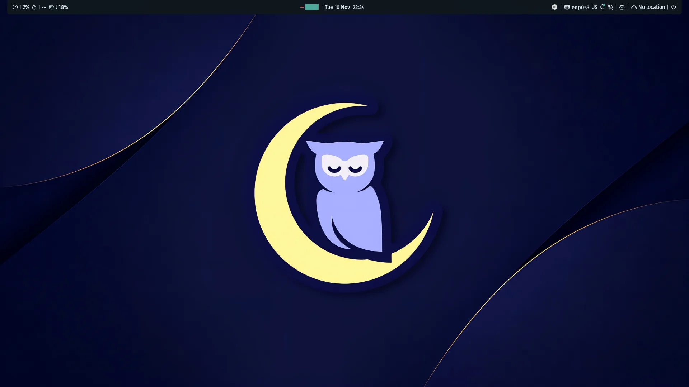
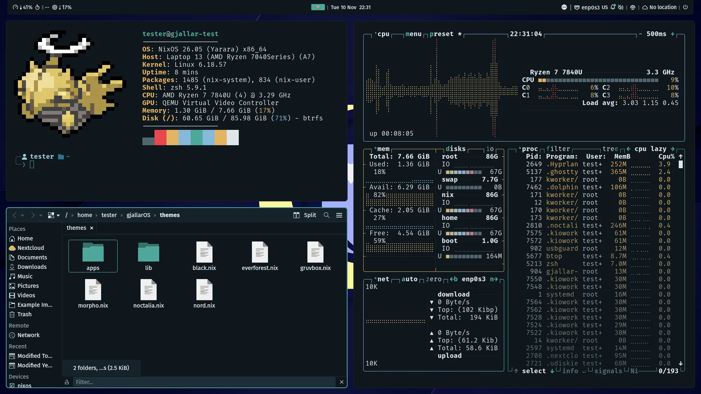
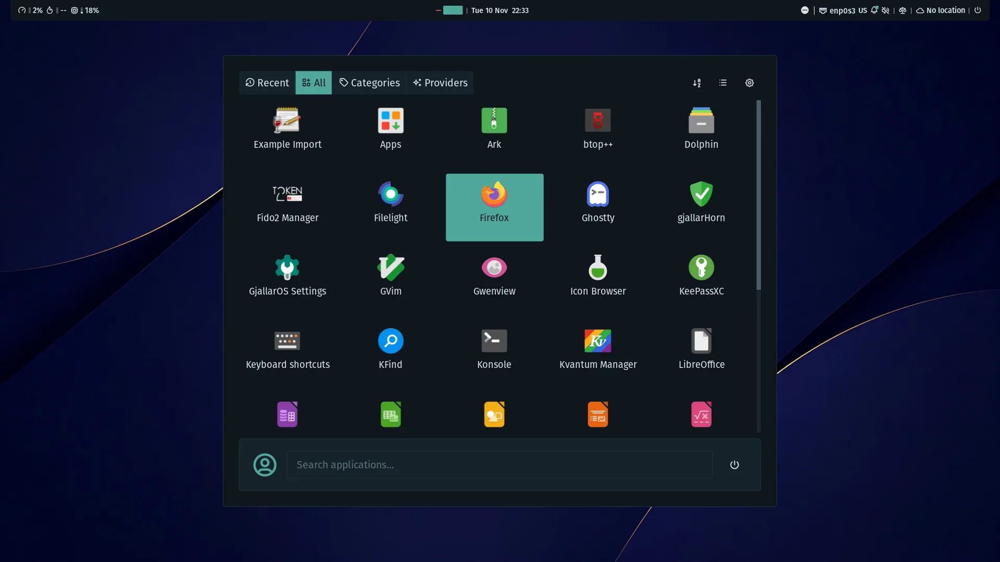
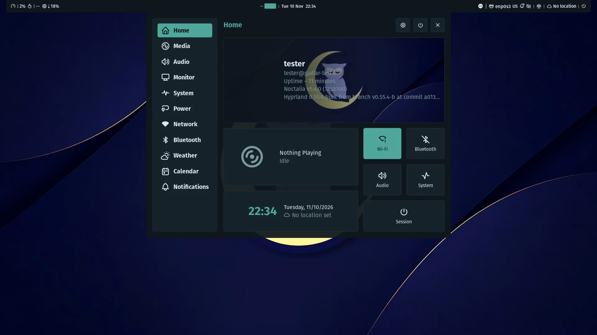
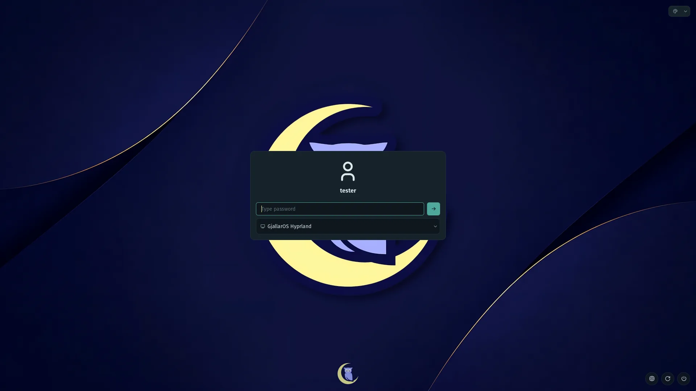
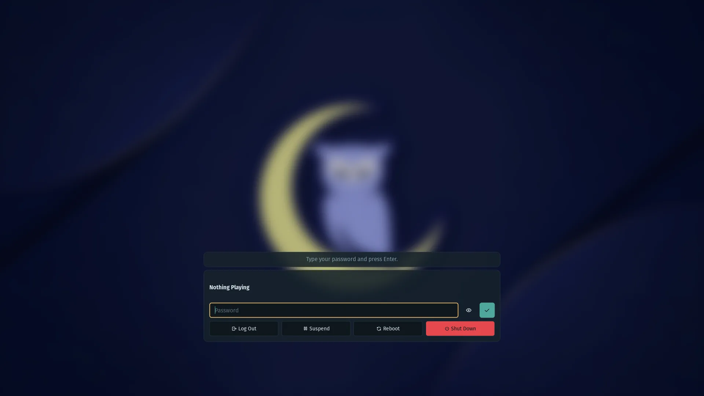
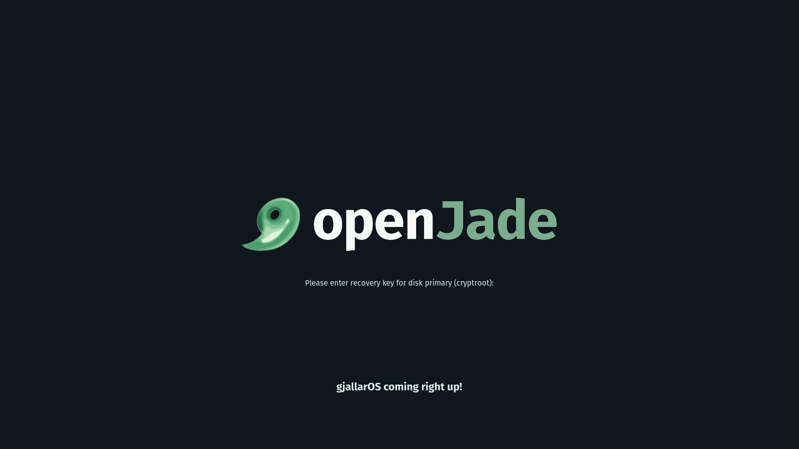

<div align="center">


# gjallarOS

**A secure, modular NixOS workstation on Hyprland**

NixOS · Hyprland · Noctalia · ODDC hardware policy · TPM2 disk encryption · reviewable installer

[Quick start](#quick-start) · [Screenshots](#screenshots) · [Features](#features) · [Keybindings](#keybindings) · [Daily use](#daily-use) · [Security](#security) · [Docs](docs/README.md)

<br>



</div>

<br>

## Quick start

Before you start:

- A 64-bit Intel or AMD machine (x86_64) that starts in UEFI mode;
  legacy BIOS (CSM) and ARM boards are not supported
- Internet for the whole install (a network cable is easiest)
- Somewhere safe off this machine for the recovery key the installer
  shows, such as a password manager on another device

Run this command on the machine that gets gjallarOS:

```bash
curl -fsSL https://raw.githubusercontent.com/JadeOpenServices/gjallarOS/stable/scripts/installation/install.sh | bash
```

> [!TIP]
> To read the script before it runs, download it first:
>
> ```bash
> curl -fsSLO https://raw.githubusercontent.com/JadeOpenServices/gjallarOS/stable/scripts/installation/install.sh
> less install.sh
> bash install.sh
> ```

<details>
<summary><b>Where the checkout goes</b></summary>
<br>

The script clones the repository with its submodules into
`~/Documents/gjallarOS` and starts the installer from there. `GJALLAR_DIR`
sets another folder, and `GJALLAR_CLONE_ONLY=1` stops after the clone.
Running it again reuses the checkout. In an existing checkout,
`./scripts/installation/install.sh` does the same.

</details>

It installs from a USB stick or on an existing NixOS. The main differences:

| What differs | From a USB stick | On an existing NixOS |
| --- | --- | --- |
| The disk | Erased; gjallarOS takes the whole disk | Kept as it is, home folder included |
| USB stick | 2 GB or more | Not needed |
| NixOS first | Not needed | Needed; another release is upgraded or downgraded to the pinned one |

### From a USB stick

This installs gjallarOS on a whole disk. Everything on that disk is
replaced, and nothing from the stick stays on the machine.

1. Download the NixOS minimal ISO for 64-bit Intel/AMD from
   [nixos.org/download](https://nixos.org/download) and compare it with
   the SHA-256 checksum listed there
2. Write the ISO to the stick with an image writer. GNOME Disks
   ("Restore Disk Image"), KDE ISO Image Writer, Fedora Media Writer,
   balenaEtcher, Raspberry Pi Imager ("Use custom") and `dd` all do
   this. Copying the file onto the stick does not make it bootable
3. Switch Secure Boot off in the firmware settings for now. The
   installer can switch it back on later
   (see [Secure Boot](#secure-boot))
4. Start the machine from the stick. The boot menu key is often F12,
   F10 or Esc. Ethernet connects by itself, and `nmtui` sets up Wi-Fi
5. Run the command above and answer the questions. The installer asks
   twice before it erases the disk you pick
6. Save the recovery key it shows somewhere off this machine. It opens
   the disk if the PIN or the security chip ever fails
7. Shut down, take the stick out and start from the disk

### On an existing NixOS

Run the command on the machine itself. The installer shows the tools it
would add to `/etc/nixos/configuration.nix` and asks once before it adds
them and rebuilds. It keeps a copy of the file as
`configuration.nix.gjallar-backup.<time>` and puts it back if the rebuild
fails. The disk layout stays as it is, so your home folder stays too.

On another NixOS release, it upgrades or downgrades to the release
gjallarOS pins, for the next start, and
leaves the running desktop alone. After the restart, it carries on where
it stopped. On a machine that already runs gjallarOS, it offers to update
it, install it again from scratch, or leave it as it is.

### What the installer asks

Each question shows its default, and Enter keeps it. In a desktop
session the questions open as dialogs, otherwise they appear in the
terminal.

| Topic | Questions |
| --- | --- |
| You and your region | Username, password, hostname, timezone, language, keyboard layout and weather location |
| Disk (USB stick) | Which disk to erase |
| Startup (USB stick) | Whether the security chip (TPM2) unlocks the disk alone or asks a PIN; both add a recovery key |
| Desktop | Login shell, editors, browsers, touchpad swipes and the closed lid on a dock |
| Apps | Apps from the catalogue, Firefox add-ons, printing and scanning, a smart card for mail keys |
| Network | Tailscale as a VPN on networks you do not trust, and Nextcloud |
| Security | USB device trust, Secure Boot, firmware updates, a recovery partition, who signs settings files |
| AI (optional) | A local model, an AI server on your network, or none |

[Install details](docs/install.md) covers release channels, preset answers
and where the installed system keeps its checkout.

> [!TIP]
> After the install, apply changes with `gjallarctl rebuild`. A plain
> `sudo nixos-rebuild switch --flake` cannot see the untracked
> `generated/` folder, see [Rebuilds](docs/configuration.md#rebuilds).

<div align="right"><a href="#gjallaros">Back to top</a></div>

## Screenshots

<table>
  <tr>
    <td colspan="2"></td>
  </tr>
  <tr>
    <td width="50%"></td>
    <td width="50%"></td>
  </tr>
  <tr>
    <td width="50%"></td>
    <td width="50%"></td>
  </tr>
  <tr>
    <td colspan="2" align="center"></td>
  </tr>
</table>

<sub>Tiling · launcher · control center · greeter · lock screen · disk unlock at boot<br>
Taken in a QEMU test VM at 1920×1080.</sub>

<div align="right"><a href="#gjallaros">Back to top</a></div>

## Features

What a fresh install brings:

| Area | What it does |
| --- | --- |
| Desktop | Hyprland with the Noctalia shell; Stylix themes the system apps as well |
| Disk encryption | LUKS2 opened by the security chip (TPM2), an optional PIN and a recovery key |
| Hardware | [ODDC](https://github.com/JadeOpenServices/oddc) knows each model's graphics, Wi-Fi, firmware and battery |
| USB trust | New USB devices wait for review; lasting trust is signed by the security chip |
| VPN and network trust | Tailscale with a trust level per network and an automatic exit node |
| Apps | One list picks them: VSCodium, Thunderbird, web apps, Wine apps in their own sandbox and more |
| Local AI | Optional Ollama on this machine, or a central HTTPS server with a sealed token |
| Snapshots | Hourly `/home` snapshots and daily ones of the settings, restored one file at a time |
| Recovery | A trusted recovery boot entry, a recovery ISO and rollback that keeps newer generations |
| Maintenance | `gjallarctl` for rebuilds, updates, cleanup and thermal status |

<details>
<summary><b>Local AI details</b></summary>
<br>

AI is optional and localhost-only, with hardware-aware model selection. On AMD
integrated graphics it runs on Vulkan instead of ROCm, and it is confined
below the desktop (memory capped at 65% of RAM, low CPU/IO priority, killed
first under memory pressure) so a model load cannot take Hyprland down. Below
8 GiB RAM no local model fits: the installer offers a central server or no
AI, and local AI then runs only a model you name. From 8 GiB it picks a 7b
model, from 24 GiB a 14b one, and with 32 GiB plus a 12 GiB graphics card a
30b one.

To turn local AI on after the install, run `gjallarctl ai enable`; the
rebuild then picks the model the same way. A changed `overrideModelWith`
takes effect with the next rebuild too.

Instead of a local model, AI can use a central server: set `aiEndpoint`
(`https://host[:port]` only), `aiRemoteModel` and `aiRemoteContextTokens`.
The server must sit behind HTTPS and check a bearer token (Ollama itself has
no login); http endpoints and missing tokens are refused. The installer asks
for the token hidden; on an installed system run `gjallarctl ai set-token`.
The token never enters the Nix store or `user.config.json`: it is encrypted
with `systemd-creds` (TPM2-bound when present) into
`/var/lib/gjallarOS/ai/endpoint-token.cred`.

</details>

<div align="right"><a href="#gjallaros">Back to top</a></div>

## Keybindings

<kbd>Super</kbd> + <kbd>F1</kbd> shows every shortcut and gesture of the
running session, searchable. The launcher has the same list as "Keyboard
shortcuts", and `gjallar-keybinds --print` prints it in a terminal.

### Apps

| Keys | Action |
| --- | --- |
| <kbd>Super</kbd> + <kbd>D</kbd> | Application launcher |
| <kbd>Super</kbd> + <kbd>T</kbd> | Terminal (Ghostty) |
| <kbd>Super</kbd> + <kbd>F</kbd> | File manager (Dolphin) |
| <kbd>Super</kbd> + <kbd>E</kbd> | Editor |
| <kbd>Super</kbd> + <kbd>B</kbd> | Browser |
| <kbd>Super</kbd> + <kbd>N</kbd> | LibreOffice (when installed) |

### Windows

| Keys | Action |
| --- | --- |
| <kbd>Super</kbd> + <kbd>Q</kbd> | Close window |
| <kbd>Super</kbd> + <kbd>W</kbd> | Fullscreen |
| <kbd>Super</kbd> + <kbd>H</kbd> <kbd>J</kbd> <kbd>K</kbd> <kbd>L</kbd> | Move focus |
| <kbd>Super</kbd> + <kbd>Shift</kbd> + <kbd>H</kbd> <kbd>J</kbd> <kbd>K</kbd> <kbd>L</kbd> | Move window |
| <kbd>Super</kbd> + left-drag | Move window |
| <kbd>Super</kbd> + <kbd>Ctrl</kbd> + arrow keys | Resize window (hold to repeat) |
| <kbd>Super</kbd> + right-drag | Resize window |
| <kbd>Super</kbd> + <kbd>Shift</kbd> + left-drag | Resize window (easier on a touchpad) |
| Drag the gap between windows | Resize window |

### Workspaces and system

| Keys | Action |
| --- | --- |
| <kbd>Super</kbd> + <kbd>1</kbd> to <kbd>0</kbd> | Switch workspace |
| <kbd>Super</kbd> + <kbd>Shift</kbd> + <kbd>1</kbd> to <kbd>0</kbd> | Move window to workspace |
| <kbd>Super</kbd> + <kbd>S</kbd> | Scratchpad workspace |
| <kbd>Super</kbd> + <kbd>Shift</kbd> + <kbd>Z</kbd> | Screenshot region |
| <kbd>Print</kbd> | Screenshot region |
| <kbd>Super</kbd> + <kbd>Escape</kbd> | Lock screen |
| <kbd>Super</kbd> + <kbd>F1</kbd> | Show all shortcuts |
| <kbd>Super</kbd> + <kbd>Ctrl</kbd> + <kbd>K</kbd> | On-screen keyboard (touch devices) |

The binds live in
[`user/wm/hyprland/keybinds.json`](user/wm/hyprland/keybinds.json), where
`$mod` is the Super key. Each one needs a `desc`, which is what the list
shows.

### On-screen keyboard

On touch devices the on-screen keyboard also opens when the device folds
into tablet mode and on the keyboard key some convertibles have. With no
keyboard attached, the login screen and the lock screen show their own
touch keyboard; with one attached, touch the password field to open it, and
a key on the keyboard closes it again. The disk unlock prompt shows its
touch keyboard on every touch device. These keyboards have letters, numbers
and symbols only: no clipboard, emoji or word suggestions.

### HP ZBook x2 Quick Keys

The bezel Quick Keys have three presets, switched with the third key from
the top. gjallarOS maps none of them: every key sends a macro key
(`XF86Macro1` to `15`) that no other key sends, so you can bind it in
Hyprland, a drawing app or any other program. The bar shows the active
preset number next to the network widget after the first key press.

<div align="right"><a href="#gjallaros">Back to top</a></div>

## Daily use

### Changing settings

Your settings live in `user.config.json`, which root owns. Change them with
`gjallarctl settings`, as your user:

```sh
gjallarctl settings list
gjallarctl settings set touchpadWorkspaceSwipe=false timezone=Europe/Berlin
gjallarctl settings pending
gjallarctl settings apply
```

Each value is JSON; a key that holds text takes plain text. Each key has a
tier, and the tier decides how long a change waits before it can be written:

| Tier | Covers | Wait |
| --- | --- | --- |
| `everyday` | Looks, input, apps | None |
| `security` | Network, services, add-ons, hostname, user name | One hour, or 10 s while your tailnet router proves you are home |
| `critical` | Disk unlock, recovery, firmware | One hour, and the password is asked at `set` and again at `apply` |
| `installer` | Set by the installer | Changes only with a new install |

The password dialog lists every key with its old and new value. Apply
writes the file and starts the rebuild, and `set` follows it until the
change is live. A waiting change lives only in your login session, so
logging out or rebooting drops it.

[Configuration](docs/configuration.md) covers saving settings to a file,
pairing two devices, signing with an OpenSSH key and how a new hostname is
checked.

### Updates

To bring the system up to date with its release channel, run:

```bash
gjallarctl rebuild --update
```

The channel is `releaseChannel`: `stable` (the default), `staging` or
`dev`. Local commits or edits in the system checkout stop the update, and
nothing is rebuilt. `gjallarctl rebuild --hardware-update` moves the
hardware catalogue to its newest release. [Rebuilds](docs/configuration.md#rebuilds)
explains channel moves and every option.

### Apps

`gjallarctl apps list` shows the catalogue and what is installed;
`gjallarctl apps add <id>` and `gjallarctl apps remove <id>` change the list
and rebuild. `gjallarctl apps change +<id> -<id> ...` makes several changes
with one password and one rebuild (`+` installs, `-` removes). The Apps page of
the settings window does the same. [App catalogue](docs/configuration.md#app-catalogue)
explains how an app is built, and [Web apps](docs/configuration.md#web-apps)
how Teams, Plane and other web apps are listed.

### Settings window and gjallarHorn

gjallarOS Settings (`gjallar-settings`) has two pages, also in the launcher on
their own: Apps and gjallarHorn. gjallarHorn shows the security checks of this
device (disk encryption, Secure Boot, USB devices, firewall, virus scan,
updates, developer mode) and a fix button where one helps.
`gjallarctl security status` prints the same checks. The window has no
rights of its own; every change goes through `gjallarctl settings` and asks
for the password.

Each row says its state in words and has one button: Install or Remove, Turn
on or Turn off. A click only marks the change; the button turns into Undo and
a bar at the bottom counts the marked changes, with Discard and Apply. Apply
installs and removes all marked apps with one password and one rebuild, then
sets the marked Wine networks and protections. Closing the window with marked
changes asks first.

A click on an app opens its page: what it is, what it can reach, its licence
and homepage, and the same button as its row. A Wine app's page also picks
its program and removes it, with or without its files in `~/WineApps`. The
licence and homepage come from the `package` in `meta.json` when the window
is built; the window fetches nothing, and Open only goes to an https
homepage.

Some protections can be turned off, for people who run their own:

| Key | Default | What it controls |
| --- | --- | --- |
| `usbguardEnable` | Asked at install | USB device review |
| `usbTrustEnforce` | Asked at install | Blocking unknown USB devices |
| `firewallEnable` | `true` | Firewall |
| `virusScanEnable` | `true` | Virus scan |

These change security-tier keys, so turning one off waits an hour away
from home, as above. Until then the card says when the change is ready and
offers Apply now and Keep it on. Turning a protection back on is stricter, so
it applies at once after the password. A protection that is off shows "Off
(your choice)" and does not ask again. The recovery system always has the
firewall on.

The virus scan is ClamAV, on demand only: no scanner daemon and no scanning of
files as they open. freshclam fetches the signatures about once an hour (the
first download is roughly 230 MB). Scan Downloads or Choose folder on the
gjallarHorn page, or `gjallarctl security scan PATH`, runs `clamscan` as you
in a sandbox without network that sees the system and your home read-only.

### Firefox add-ons

Add-ons come in collections, listed in `apps/firefox-addons.json`: Privacy,
Password managers, Comfort and Cookie banners. New installs start with uBlock
Origin on and everything else off. Each add-on has one of three modes:

| Mode | What it means |
| --- | --- |
| `off` | Not installed; if gjallarOS installed it earlier, it is removed |
| `on` | Installed, and you can turn it off in about:addons |
| `locked` | Installed and always on |

The installer asks which collections you want, then the mode of each add-on in
them. Afterwards `gjallarctl addons` changes them:

```sh
gjallarctl addons list
gjallarctl addons set privacy.clearurls on
gjallarctl addons set comfort off
gjallarctl rebuild
```

In `user.config.json` this looks like:

```json
"firefoxAddons": {
  "privacy": { "enable": true, "addons": { "ublock-origin": "on", "clearurls": "locked" } }
}
```

Add-ons of a collection are only installed while its `enable` is `true`.
Missing add-ons count as `off`.

Add-ons from addons.mozilla.org are pinned to one reviewed file.
`gjallarctl addons pin ID` downloads the newest version, shows its name and
permissions and asks before it saves the URL and SHA-256 to
`firefoxStoreAddons`. The build fetches exactly that file, so a changed file
on addons.mozilla.org breaks the build instead of reaching Firefox.
`gjallarctl addons update` moves pins to the newest version and lists the
permissions the new version adds. About:support shows the ID of each
installed add-on.

Firefox installs all of these through its enterprise policy, from the Nix
store, and does not update them by itself; new versions arrive with
`gjallarctl rebuild`. The rebuild, or the next login if Firefox was open,
removes add-ons that left the list, but only those Firefox itself installed
from the policy. gjallarOS keeps a list of them in
`~/.local/state/gjallaros/managed/`. Add-ons you installed by hand stay
untouched. JODS and unattended installs set `firefoxAddons` and
`firefoxStoreAddons` in the same way. Coming from an older version?
[Firefox add-ons from older versions](docs/upgrading.md#firefox-add-ons-from-older-versions)
says what to do.

### Nextcloud files

The Nextcloud client is in the default apps. To connect it, set the server in
`user.config.json` and rebuild:

```json
"nextcloudEnable": true,
"nextcloudHost": "https://cloud.example.org"
```

Only `https` addresses are accepted. Start Nextcloud from the app menu, or run
`nextcloud-enroll`, and log in. Files appear in `~/Nextcloud` and in Dolphin.

Everything starts as a placeholder: you see every file, but nothing is
downloaded until you open it. Right after the login a "Keep on this device"
window lists your top-level folders with nothing ticked. Tick the folders you
want offline; they download and stay. "Not now" or closing the window keeps
everything online-only. New top-level folders that show up later are
placeholders too.

Change it later in Dolphin: right-click a file or folder and pick "Make always
available locally" or "Free up local space". The folder settings in the
Nextcloud window have the same two actions. Your picks stay on this device
only; another device of yours starts with everything online-only again.

If the client crashes, it starts again after ten seconds. After five starts in
five minutes it stays off, and Quit in the tray stops it as well; open
Nextcloud from the app menu or log in again to bring it back.

### Thunderbird

Thunderbird (latest release) is in the default apps; the installer asks
before it installs it. You set up every account yourself. On the first start a
local page walks through the account, the Primary Password, your OpenPGP key
and its backup, and Nextcloud calendar and contacts.

gjallarOS sets these through Thunderbird's enterprise policy:

- A Primary Password is asked before the first saved password, and it cannot
  be removed. It protects saved passwords, login tokens and OpenPGP keys
- Remote content in mail stays blocked; you allow it per sender. Scam
  warnings stay on. Account autoconfig uses HTTPS only, and connections need
  TLS 1.2 or newer
- Mail shows as simple HTML (View, Message Body As changes it). Chat,
  telemetry, donation and survey messages are off
- Only dictionaries, languages and themes can be added, no add-ons with code
- Key servers are searched only when you ask for a key

Every `mailto` link opens Thunderbird, Firefox ones included.

Smart cards are off by default. The installer asks after Thunderbird, or set
it later (security tier):

```sh
gjallarctl settings set thunderbirdSmartCard=true
gjallarctl settings apply
```

This starts `pcscd` and `gpg-agent`, lets Thunderbird use a card key through
GnuPG, and adds OpenSC for S/MIME cards. Approve the card reader when
gjallarOS asks about the new USB device.

### Snapshots

Installs made with the subvolume layout keep read-only Btrfs snapshots of
`/home` (hourly) and of the system settings in `/etc/gjallar/system` (daily,
and before and after each rebuild). `/`, `/nix` and `/var/lib` never get
snapshots: generations bring the system back, and the machine keys in
`/var/lib` must not live on in old copies. Older installs get no snapshots
until they are reinstalled.

Three keys control them:

| Key | Default | Meaning |
| --- | --- | --- |
| `snapshotsEnable` | `true` | Turns the snapshot timers on or off |
| `snapshotsKeepHours` | `24` | Hours of hourly `/home` snapshots to keep (0 to 168) |
| `snapshotsKeepDays` | `7` | Days of daily snapshots to keep (1 to 365) |

Only root can reach the snapshots; they are mounted nowhere on the running
system. When the disk is nearly full, no new snapshot is made and the
journal says so (`journalctl -u gjallar-snapshot-home`).

To get an older version of one of your files back:

```bash
gjallarctl snapshots list
gjallarctl snapshots restore ~/Documents/notes.txt
```

`restore` asks your password and takes the newest snapshot that has the
file, or the one you name with `--from SNAPSHOT`. The copy goes next to the
file, as `notes.restored-20261021T030000.txt`; your current file is never
touched. If the folder is gone too, add `--to FOLDER`. Only plain files in
your home can be restored, one at a time.

To put all of `/home` or the settings back, start the trusted recovery boot
entry and run the lines below. From the recovery partition, unlock with
`gjallar-recover open-root DEVICE` first and use `/mnt` instead of `/`.

```bash
sudo gjallar-recover snapshots /
sudo gjallar-recover snapshot-rollback / home.20261021T030000+0200
```

It asks you to type `ROLLBACK-HOME` (or `ROLLBACK-CONFIG` for a `config.`
snapshot). The snapshot itself stays as it was; the current `/home` is kept
as a read-only copy in the list under "replaced by a rollback". When `/home`
is in use, the change takes effect at the next start. After a settings
rollback, run `gjallarctl rebuild` once the system is up so the system
matches the settings again. `sudo gjallar-recover snapshot-drop / NAME`
deletes a kept copy once you no longer need it.

> [!WARNING]
> A file you delete from `/home` stays in older snapshots until they age
> out. Snapshots live on the same disk, so they are not a backup.

### Recovery and rollback

With `recoveryEnable`, the boot menu lists only the newest generation and its
recovery entries. To boot an older generation, start trusted recovery (or the
recovery ISO, with the root mounted at `/mnt`) and run:

```bash
sudo gjallar-recover generations /
sudo gjallar-recover rollback / N
```

This adds a new generation with that system; nothing newer is deleted.

The recovery partition shows up in the same menu as "gjallarOS recovery
(partition)". It has no firmware boot entry of its own and no loader at the
removable-media path, so firmware that ignores the boot order still starts
gjallarOS. If the ESP itself is broken, boot the recovery ISO from USB.

> [!NOTE]
> The installed system does not carry the installer. `gjallar-installer` and
> `gjallar-recovery-maintenance` (package `pkgs/gjallar-installer`) can
> repartition and reinstall a disk, so they exist only in the trusted-recovery
> boot entry, the recovery-maintenance initrd and the recovery ISO. A reinstall
> or reset therefore needs a deliberate boot into recovery.

<div align="right"><a href="#gjallaros">Back to top</a></div>

## Security

The gjallarHorn page of the settings window shows how each of these stands
on this device.

### Secure Boot

The installer asks about Secure Boot before the recovery questions, since the
recovery partition is signed with this machine's Secure Boot key. What it
offers depends on the machine:

| Your machine | What the installer offers | Default |
| --- | --- | --- |
| Model with an ODDC Secure Boot setup | Secure Boot | Yes |
| Model without one | Shim (below) as an untested try, checked against this firmware before the final question | No |
| Secure Boot already on | The offer only when shim already starts the running system | As above |

Saying no, or a model without an ODDC Secure Boot setup, shows what the
install goes without: nothing checks the startup files, the disk passphrase
is typed at every startup, repairs start from a USB stick, and JODS cannot
manage the machine. Without Secure Boot there is no recovery partition and
the disk is not shrunk for one. A system installed without it gets it with:

```bash
gjallarctl secure-boot setup
```

On a machine that still has its maker's keys, `setup` goes through shim and
leaves the firmware keys alone. The firmware starts shim, which is signed by
Microsoft, and shim checks gjallarOS's own key, which you confirm once in
MokManager. This works on any model whose firmware trusts the pinned shim,
also without an ODDC entry. The command checks that first: db must hold the
certificate that signed shim, and dbx and shim's SBAT level must not revoke
it. Each run does one step and says which restart comes next:

1. Create the key, turn on `secureBootEnable` and `secureBootShim`, rebuild
   and restart
2. Queue the key for MokManager (`mokutil --import`, with a one-time
   password), restart and confirm it on the blue MokManager screen
3. Turn on Secure Boot in the firmware setup. The first Secure Boot start
   records the switch and verifies it

That check refuses unsigned files in the gjallarOS folders of the EFI system
partition (`EFI/nixos`, `EFI/BOOT`, `EFI/systemd`, `EFI/Linux`). Unsigned files
in other folders, such as another system's boot loader, only give a warning:
they stay where they are, and the firmware and shim decide whether they start.

`gjallarctl secure-boot setup --own-keys` replaces the firmware keys with
gjallarOS keys instead. It needs an ODDC Secure Boot setup for the model. The
command also takes this path on its own when the firmware is already in Setup
Mode, or when db or dbx would stop shim.

The own-keys path takes the installer's steps: it checks the firmware state,
creates the keys and shows their recovery archive, turns on
`secureBootEnable`, rebuilds and offers to restart into firmware setup. After
the restart the boot services enrol the keys and verify them. On both paths,
run the command again after a step was interrupted; it picks up where it
stopped. `gjallarctl secure-boot status` shows the current state.

Some firmware empties its revocation list (dbx) along with its keys. When the
ODDC setup wants dbx kept, the firmware's own default list is written back
before enrolling, and enrolment stops if that fails. Firmware that only knows
Microsoft's 2011 KEK (expired June 2026) also gets the 2023 one, so revocation
updates signed with it still apply once gjallarOS owns the keys.

Revocation updates do not arrive on their own. Once Secure Boot is on, `setup`
offers one, and you can check any time with:

```bash
gjallarctl secure-boot update-dbx
```

The new list takes effect at the next restart. With TPM disk unlock, the TPM
accepts the current and the new state until then, so a rebuild in between
still unlocks.

### USB trust

The installer asks for USB trust review on machines with an ODDC model. On a
machine with TPM2 it sets the signing handle (`usbTrustTpmHandle`, default
`0x81000042`), and the broker creates the TPM signing key on its first start.
A key left at that handle by an earlier install on the same TPM is reused; any
other object there is never overwritten, and permanent trust stays off until
you pick a free handle. `sudo gjallarctl usb provision-key` does the same step
by hand. Creating the key trusts no devices; inspect `gjallarctl usb status`
and review devices first.

With an encrypted root, the installer also asks "Block unknown USB devices from
the first boot?" (default no). Say no on a desktop with a USB keyboard: it is
not built in, so it stays blocked until approved. Enforcement can be turned on
later with `"usbTrustEnforce": true` in `user.config.json` and a
`gjallarctl rebuild`. To turn it off, run `sudo gjallarctl usb disarm` first
and enter the disk encryption passphrase, then set it back to `false` and
`gjallarctl rebuild`. Disarm alone is temporary: the broker re-arms from the
config on its next restart, or right away with `sudo gjallarctl usb arm`. The
other order is refused by `gjallarctl settings`; done by hand, USBGuard keeps
blocking unknown devices at boot while the stored state still says armed.

Turning USB trust off altogether (`"usbguardEnable": false`) takes effect for
new USB devices at the next reboot. Until then a newly plugged device stays
off: USBGuard does not hand the ports back to the kernel's default when it
stops, because anything that stops it would then let every device in.

On a machine with TPM2 the installer also asks "Let approved USB devices expire
when unused?" (default no). With it on, an approved external device that was
not connected for `usbTrustLapseDays` days (30 by default, any number from 1)
asks for approval again. The days count from the last connection, and from the
moment the setting was turned on, so old devices do not all ask at once. Three
days before a device expires, a notice offers to renew it. Built-in devices
never expire. Without a built-in USB keyboard, the keyboard and mouse used last
never expire either. `gjallarctl settings` turns it on or shortens it at once;
turning it off (`0`) or lengthening it waits out the security delay.

With enforcement on, approving a USB device does not open its storage. Every
stick, memory card, disc and disk, a disk in a dock or enclosure included,
stays closed until you open it from its notice. A disk in a dock is named by
the disk inside, then the dock. Storage closes again when the medium is
swapped, when the device is unplugged, and when the USB trust service
restarts. A rebuild can restart it, so unmount USB disks before a rebuild.

The review dialog opens in a simple view. "Techy view" shows IDs, ports and
interfaces for that dialog only. The "Always techy view" box writes
`"usbReviewTechnicalView": true` or `false` into `user.config.json`, so the
choice stays until someone unticks it. Someone debugging the laptop can tick
it, work, and untick it to give the user the simple view back. Editing the key
by hand does the same.

A USB disk with no file system offers to format it as exFAT. Cancel leaves
it as it is. A disk that already has partitions or a known file system is
never offered. gjallarOS cannot tell whether an unformatted disk holds data,
so check first.

### Tailscale VPN and network trust

The installer can turn on Tailscale and use a tailnet exit node as VPN.
`gjallar-vpn-trust` then decides on every network change, tailnet change, and
every five minutes how far to trust the current network:

| Network | Local network reachable | Exit node |
| --- | --- | --- |
| `home` | Home subnets, or this LAN when a router proved it | Off |
| `site` | This LAN | Off |
| `trusted-wifi` | This LAN | Off, or the one set for that Wi-Fi |
| `untrusted` | None | The `exitNode` setting |
| `offline` | None | Unchanged |

How each one is recognised:

- `home` is a home subnet, proven by a trusted Wi-Fi name or your tailnet
  router answering on it
- `home` with `routerHome` is any LAN where a subnet router of your tailnet
  answers, yours or a friend's
- `site` is a LAN with a tailnet subnet router that reaches every listed site
  host
- `trusted-wifi` is a trusted Wi-Fi name on a network that needs a key
- `untrusted` is anything else
- `offline` means no default route

The keys behind it: `routerHome` turns on the router case of `home`,
`siteRouterTrust` and `siteRouterTargets` set up `site`, `trustedWifis` lists
the trusted Wi-Fi names and `wifiExitNodes` their exit nodes.

> [!WARNING]
> A trusted name on an open network only produces a warning, since anyone can
> clone it.

> [!WARNING]
> With `routerHome`, every LAN behind a router of your tailnet is home. A travel
> router in a hotel is one too, so the hotel network sees your traffic unless
> that router sends it through its own VPN.

Router proof is a signed Tailscale ping answered from this LAN or by its
gateway, so copying a subnet or a Wi-Fi name is not enough. Every member of the
tailnet counts, tagged routers too, because the tailnet admin approves each
subnet route. A node shared in from another tailnet never counts as a router:
Tailscale does not pass on its subnet routes. It can still be your exit node
when its owner allows that, so a friend's exit node works too.

`exitNode` is a tailnet host name or 100.x address; `auto` picks an
online exit node, preferring one that routes a home subnet; `off` keeps it off
everywhere; empty leaves the exit node to you unless `wifiExitNodes` is set.
On an untrusted network the VPN fails closed: when the exit node is offline,
none can be set or Tailscale is not running, the internet is blocked outside
the tunnel instead of going around it. The local network and DHCP still work;
DNS does not, so the network cannot see what you look up. A notice says which
side failed, and the shield in the bar shows the block.

To get online anyway, for example to sign in to a captive portal or to
Tailscale again, pause the VPN on that network from the notice, the bar or
`gjallarctl vpn pause`. It asks for an administrator's password every time and
ends after one hour, on a network change, before sleep or on a restart, or
when you click the shield again (`gjallarctl vpn resume`). While paused, the
network sees where apps connect. `gjallarctl vpn status` shows the block or
the pause.

LAN access stays on while an exit node is active so captive portals and
printers keep working. DNS then goes to the exit node, so a home router's
filtering also applies away from home unless the tailnet's admin console
overrides DNS. `gjallarctl vpn status` shows the current decision.

<details>
<summary><b>Change trust at runtime</b></summary>
<br>

These commands run as root. In the examples, `Home` is a Wi-Fi name and
`router` an exit node of your tailnet:

| Command | What it does |
| --- | --- |
| `gjallarctl vpn trust-wifi` | Trusts the current Wi-Fi |
| `gjallarctl vpn trust-wifi Home --exit-node router` | Trusts that LAN and sends the internet through `router` |
| `gjallarctl vpn trust-wifi Home --exit-node default` | Trusts that LAN with the exit node off |
| `gjallarctl vpn untrust-wifi Home` | Takes the trust back |
| `gjallarctl vpn exit-node auto` | Sets the exit node; also takes `off`, a name or `default` |

Changes apply at once and are kept in `/var/lib/gjallar/vpn-trust-override.json`,
layered over the built-in policy in `/etc/gjallar/vpn-trust.json`, so they
survive rebuilds. To make them permanent, replace the `tailscale = { ... };`
line in `generated/state.nix` with the output of `gjallarctl vpn export`,
rebuild, then delete the override file.

</details>

### Time

The clock is set only over NTS, which signs the time so nobody on the
network can change it: Cloudflare, Netnod, PTB and time.nl, one server each.
At least two of them have to agree before chrony moves the clock. Plain NTP,
the NixOS pool and time servers handed out by DHCP are not used, on any
network. When no NTS server answers, for example on a network that blocks
TCP port 4460, the clock keeps running from where it was.
`gjallarctl system status` shows `Time: confirmed by NTS at ...`, or
`Time: not confirmed since ...` when no server has confirmed it in the last
two hours. While the time is not confirmed, a clock shows in the bar; click
it for details, or run `gjallarctl system time`. When it stays unconfirmed
for 24 hours while you are online, a card says so once. The design and the
next steps are in section 18 of
[ROADMAP.md](ROADMAP.md).

<div align="right"><a href="#gjallaros">Back to top</a></div>

## Credits

gjallarOS builds on the ideas and groundwork of
[AlfheimOS](https://github.com/Serpentian/AlfheimOS) and the
[hyprdots](https://github.com/prasanthrangan/hyprdots) project.
[v3rm1n's dotfiles](https://codeberg.org/v3rm1n/dotfiles) inspired it
and got me started on this idea in the first place, together with my
loving hate for Windows and what it has become, as an ex-Windows user
since 2021. Please send some love their way as well.

The desktop shell, greeter and default owl wallpaper come from
[Noctalia](https://github.com/noctalia-dev/noctalia). The README layout
takes inspiration from [HyDE](https://github.com/HyDE-Project/HyDE).

## Licence

gjallarOS is licensed under the GNU Affero General Public License v3.0 or
later; see [LICENSE](LICENSE). Bundled parts keep their own licences:

- [`pkgs/monique`](https://github.com/vardstein/monique): GPL-3.0
- [`apps/nemu/module.nix`](apps/nemu/module.nix): nemu's upstream NixOS
  module, BSD-2-Clause, licence text in the file header
- [`themes/brand/openjade`](themes/brand/openjade/README.md): the OpenJade
  logo is a trademark and not covered by the AGPL

<div align="right"><a href="#gjallaros">Back to top</a></div>

---

<sub>&nbsp;<b>openJade</b> · gjallarOS</sub>
